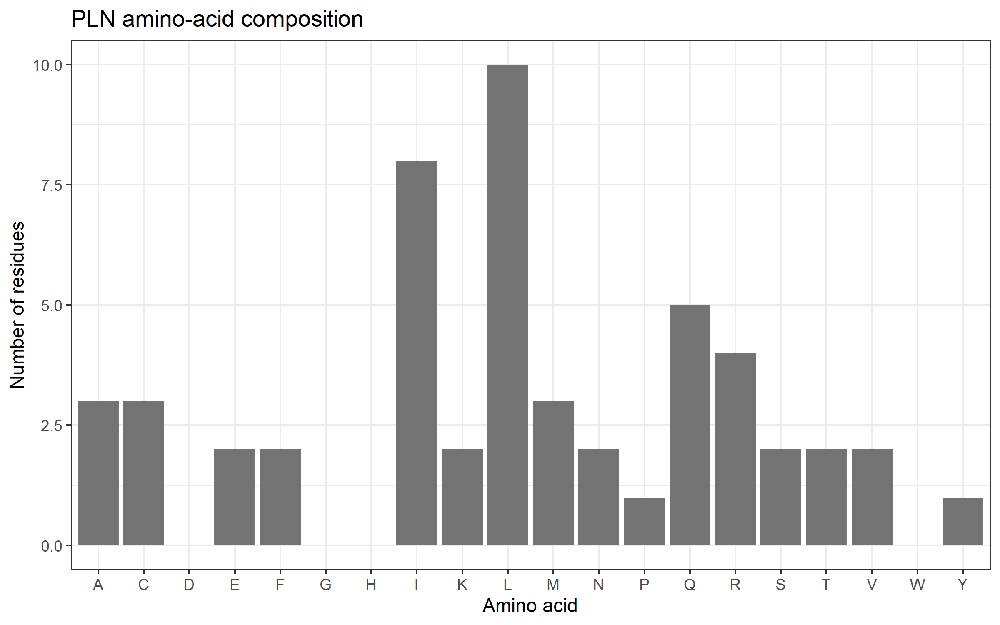
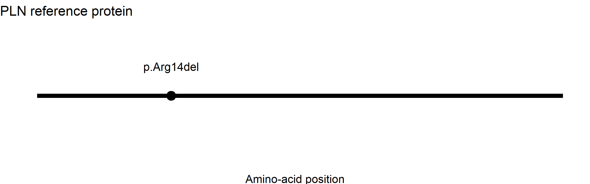

# Molecular Mechanisms of Muscle Contractility: PLN p.Arg14del
**Student:** Puyat, Doreen Marie G.

- **Gene symbol:** PLN
- **Gene name:** Phospholamban
- **Organism:** *Homo sapiens*
- **Reference transcript:** NM_002667.5
- **Reference protein:** NP_002658.1
- **Assigned variant:** NM_002667.5:c.37AGA[1] (p.Arg14del)
- **ClinVar Variation ID:** 44580
- **Variant type:** In-frame deletion

## Methods

### Step 1. Set Up of RStudio Project

 **Figure 1. Screenshot of the RStudio project showing Analysis.R and the subfolders (figures, data, results).**

 ### Step 2. Retrieved the Human PLN Gene Record

**Figure 2. Screenshot of the NCBI Gene record and the generated gene_summary.txt file.**

### Step 3. Retrieved the Reference Protein Sequence

**Figure 3. Screenshot of the transcript record showing the linked protein accession, and the FASTA header showing the protein accession.**

### Step 4. Analyzed Protein Length and Amino-Acid Composition

**Table 1.** Full amino‑acid composition of PLN (NP_002658.1; 52 amino acids)

| AminoAcid | Count |
|-----------|------:|
| A         | 3     |
| C         | 3     |
| D         | 0     |
| E         | 2     |
| F         | 2     |
| G         | 0     |
| H         | 0     |
| I         | 8     |
| K         | 2     |
| L         | 10    |
| M         | 3     |
| N         | 2     |
| P         | 1     |
| Q         | 5     |
| R         | 4     |
| S         | 2     |
| T         | 2     |
| V         | 2     |
| W         | 0     |
| Y         | 1     |

**Figure 4. Amino-acid composition of the human PLN reference protein. The bar chart shows the number of occurrences of each of the 20 standard amino acids in the 52-amino-acid reference phospholamban sequence, NP_002658.1. Leucine was the most frequent amino acid, followed by isoleucine and glutamine.**

### Step 5. Examined the Assigned ClinVar Variant

**Figure 5. Screenshot of the ClinVar record showing Variation ID 44580, the variant notation, classification, and review status.**

### Step 6. Second Biological Visualization

**Figure 5. Linear protein map showing the position affected by PLN p.Arg14del. The gray line represents the full-length reference PLN protein of 52 amino acids. The red marker identifies position 14, where arginine is deleted in the assigned variant.**

## Molecular Mechanism of the PLN p.Arg14del Variant

### 1. Describe what your normal protein does in skeletal, cardiac, or smooth muscle (as appropriate). Identify whether it drives the actin–myosin cycle, regulates calcium, or maintains musclestructure.

The PLN gene encodes phospholamban, a small protein that regulates calcium movement in cardiac muscle. It controls SERCA2a, a calcium pump that returns calcium to the sarcoplasmic reticulum after contraction. This helps the heart muscle relax before the next heartbeat. Phospholamban regulates calcium; it does not directly drive the actin–myosin cycle.

### 2. Explain what is known about the assigned variant, separating observed experimental evidencefrom computational prediction and clinical

The assigned variant, p.Arg14del (ClinVar Variation ID 44580), deletes arginine at amino-acid position 14 without shifting the reading frame.

- **Experimental evidence:** Studies have reported that this variant can disrupt phospholamban function and affect SERCA calcium-pump regulation.
- **Clinical evidence:** The variant is associated with inherited cardiomyopathy and is classified as Pathogenic in ClinVar.
- **Computational evidence:** The protein map shows the location of the deletion, but it does not prove how the variant affects protein function.

The exact mechanism and why disease severity differs among individuals remain incompletely understood.

### 3. Write a short causal chain: gene → protein → molecular function →assigned variant →possibleeffect on contraction, relaxation, or muscle integrity.

PLN gene → phospholamban protein → regulates SERCA2a and calcium reuptake → p.Arg14del removes arginine 14 → altered calcium handling → possible disruption of normal heart muscle contraction and relaxation → increased risk of cardiomyopathy.

### 4. Propose one experiment that could test your interpretation, such as ATPase measurement, calcium imaging, binding assay, microscopy, or force measurement.

Compare cardiac cells with normal phospholamban to cells with the p.Arg14del variant by measuring calcium levels with a fluorescent indicator. Now if the variant cells show changes in how quickly calcium is removed from the cytoplasm, this would support the idea that the variant affects calcium regulation.

## Questions and Answers

### 1. What does the assigned gene encode, and how does this protein contribute to muscle function?

The PLN gene produces phospholamban, a protein that regulates the SERCA calcium pump in heart muscle cells. SERCA moves calcium back into storage, helping the heart muscle relax after contraction. Therefore, phospholamban helps control normal heart muscle contraction and relaxation.

### 2. What was the exact protein accession and length retrieved with R?

The protein accession is NP_002658.1. The reference phospholamban protein contains 52 amino acids, as confirmed by the FASTA file and amino-acid count.

### 3. What did the amino-acid composition chart show? What can it NOT tell you?

The chart showed that leucine (L) was the most abundant amino acid, with 10 residues, followed by isoleucine (I) with 8 and glutamine (Q) with 5.

However, the chart cannot show the protein's three-dimensional shape or prove how a variant affects protein function or causes disease.

### 4. What is the assigned ClinVar variant, and what is its classification and evidence strength?

The assigned variant is PLN NM_002667.5:c.37AGA[1] (p.Arg14del), ClinVar Variation ID 44580. It is an in-frame deletion that removes arginine at position 14 without shifting the reading frame.

ClinVar classifies it as Pathogenic, with multiple submitters agreeing and no conflicting classifications. Supporting evidence includes affected patients, family studies, and functional experiments.

### 5. What is the proposed mechanism linking this variant to muscle function, and what remains uncertain?

The variant removes one arginine from phospholamban and may disrupt its regulation of the SERCA calcium pump. This can affect calcium movement in heart muscle cells and is associated with cardiomyopathy.

However, the protein map and amino-acid chart do not prove this mechanism. The exact molecular changes and reasons why disease severity differs among individuals are not fully explained by these figures alone.

### 6. What additional experiment would help test the proposed mechanism?

Researchers could compare heart muscle cells with normal phospholamban and cells with the p.Arg14del variant. Using a fluorescent indicator, they could measure how quickly calcium leaves the cytoplasm after contraction and compare SERCA activity.

If the variant cells show different calcium movement or SERCA activity, this would support the proposed mechanism. The experiment should include proper controls and repeated biological samples.

## Discussion

The PLN gene encodes phospholamban, a small protein that regulates calcium movement in cardiac muscle cells. Phospholamban regulates SERCA2a, a calcium pump that returns calcium to the sarcoplasmic reticulum after contraction. This process helps the heart muscle relax before the next heartbeat. Therefore, changes in phospholamban function may disturb calcium handling and affect normal cardiac function.

The reference protein retrieved for this project was NP_002658.1, containing 52 amino acids. The amino-acid composition analysis showed that leucine was the most abundant amino acid (10 residues), followed by isoleucine (8) and glutamine (5). This analysis describes the composition of the reference sequence, but it cannot determine the protein's three-dimensional structure, directly measure its activity, or establish whether a variant causes disease.

The assigned variant, PLN p.Arg14del, is an in-frame deletion that removes arginine at amino-acid position 14. ClinVar Variation ID 44580 currently classifies this variant as pathogenic. Clinical reports have linked it to inherited cardiomyopathy, and family studies have provided evidence of segregation with disease. These findings support a clinical association between the variant and cardiomyopathy.

Experimental evidence also supports a functional effect. Haghighi et al. (2006) investigated the variant in a family affected by hereditary cardiomyopathy and in experimental models. Other functional studies cited in ClinVar have reported effects on phospholamban function and calcium-pump regulation. However, the amino-acid composition chart and protein-position map generated in this project do not demonstrate these effects themselves. They are sequence-based visualizations, not functional experiments.

Computational predictions, where available, may suggest possible effects on protein structure or function, but they are not equivalent to direct experimental evidence. ClinVar notes that computational algorithms were not available or were not evaluated in at least one clinical submission for this variant. Therefore, the pathogenic interpretation is supported by clinical observations and functional research, rather than by this project's plots alone.

A useful follow-up experiment would compare cardiac cells expressing normal phospholamban with cells expressing p.Arg14del. Calcium imaging could measure how quickly calcium levels decrease after contraction, while a SERCA activity assay could evaluate calcium-pump function. Appropriate controls and biological replicates would be needed. These experiments could test whether the variant changes calcium handling and help clarify its contribution to cardiac dysfunction.

## References and Database Links

1. **NCBI Gene:** https://www.ncbi.nlm.nih.gov/gene/
2. **NCBI RefSeq transcript NM_002667.5:** https://www.ncbi.nlm.nih.gov/nuccore/NM_002667.5
3. **NCBI RefSeq protein NP_002658.1:** https://www.ncbi.nlm.nih.gov/protein/NP_002658.1
4. **NCBI ClinVar, Variation ID 44580:** https://www.ncbi.nlm.nih.gov/clinvar/variation/44580/
5. Haghighi, K. et al. (2006). A mutation in the human phospholamban gene, deleting arginine 14, results in lethal, hereditary cardiomyopathy. *Proceedings of the National Academy of Sciences*. [Find article via PubMed](https://pubmed.ncbi.nlm.nih.gov/16432188/).

**Database access date:** [October 27, 2026]

